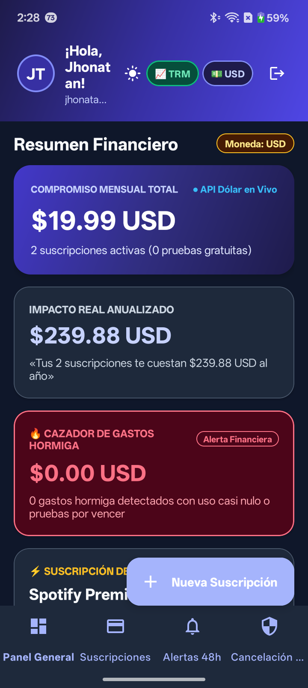
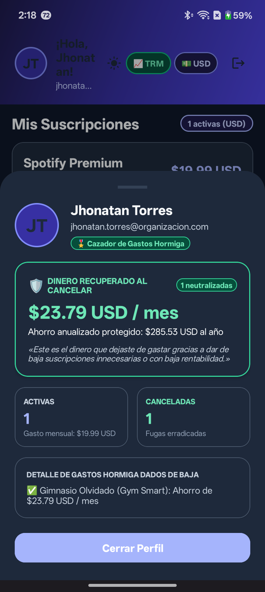
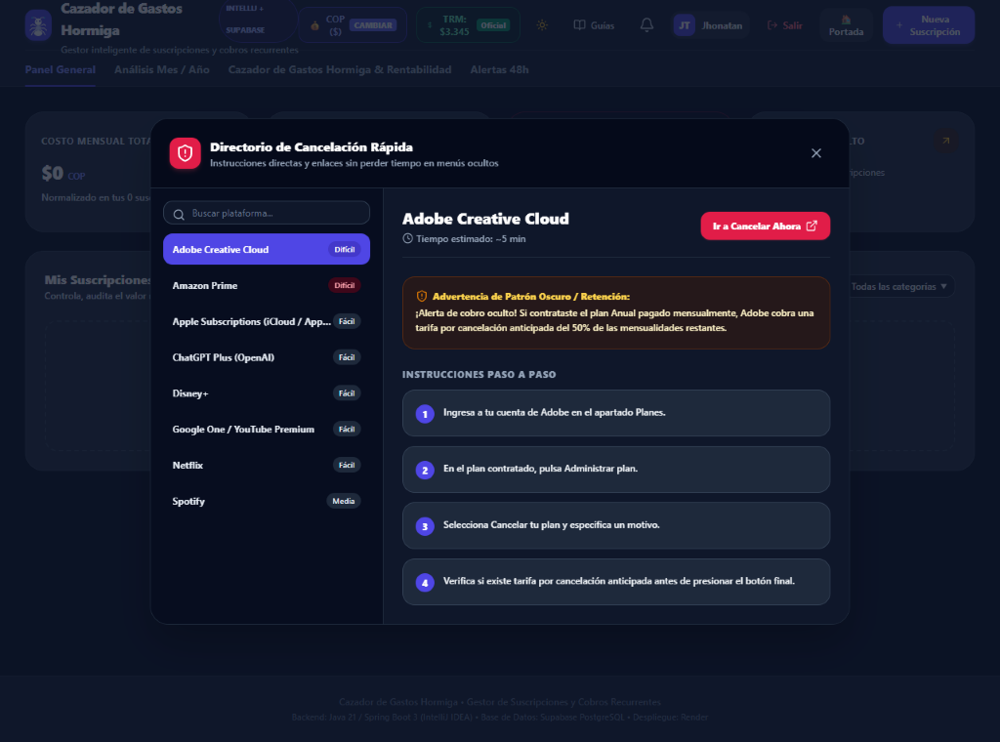
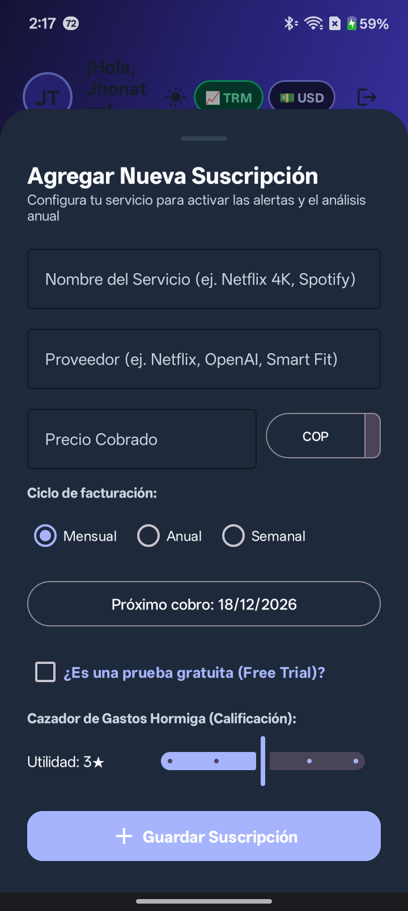
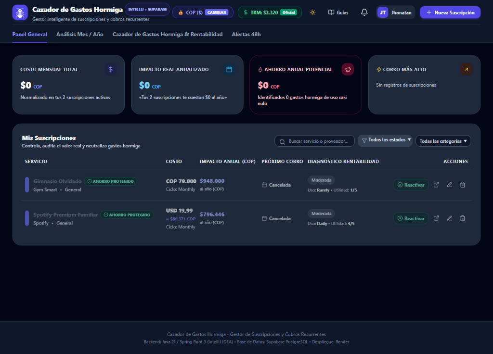

# 🐜🛡️ Cazador de Gastos Hormiga
### *Gestor Inteligente de Suscripciones, Detección de Fugas de Capital y Optimización Financiera Personal*

<p align="center">
  <a href="https://github.com/JohnTorres24/Hormiga/raw/main/release/cazador-gastos-hormiga-v1.0.apk">
    
  </a>
  <a href="https://johntorres24.github.io/Hormiga/">
    
  </a>
  <a href="https://cazador-gastos-hormiga-api.onrender.com/api/health">
    
  </a>
</p>

<p align="center">
  
  
  
  
  
  
  
</p>

---

## 📖 ¿En qué se basa Cazador de Gastos Hormiga?

En la economía digital contemporánea, el modelo de suscripción periódica se ha convertido en una de las fuentes principales de descapitalización involuntaria. Los denominados **«gastos hormiga digitales»** son aquellos micropagos automatizados —servicios de streaming olvidados, pruebas gratuitas (*free trials*) no canceladas a tiempo, suscripciones a aplicaciones móviles que ya no se usan, planes de almacenamiento en la nube redundantes o membresías de gimnasios no aprovechadas— que, de forma individual, aparentan un impacto insignificante, pero que sumados erosionan drásticamente el patrimonio personal.

Un usuario promedio mantiene entre tres y siete cobros automáticos activos en su tarjeta de crédito o cuenta bancaria sin auditar su frecuencia de uso real ni su rentabilidad. Un servicio de apenas \$19.99 USD al mes se traduce silenciosamente en más de **\$796.000 COP al año**, dinero que sale del bolsillo del consumidor sin aportar valor proporcional.

**Cazador de Gastos Hormiga** no es una simple libreta pasiva de apuntes contables: es una **plataforma de defensa financiera proactiva** diseñada para:
1. **Identificar** con precisión analítica cada compromiso recurrente.
2. **Diagnosticar** la rentabilidad de cada cobro mediante un algoritmo de utilidad contra frecuencia de uso.
3. **Alertar** con 48 horas de antelación para impedir renovaciones automáticas indeseadas.
4. **Monitorear el riesgo cambiario** calculando la sensibilidad del gasto ante las fluctuaciones del dólar (TRM oficial en tiempo real).
5. **Guiar al usuario** paso a paso para neutralizar los *patrones oscuros* (*dark patterns*) que las plataformas emplean para dificultar la cancelación.
6. **Recompensar la disciplina financiera** mediante un perfil que cuantifica el **dinero recuperado de forma permanente** por cada suscripción dada de baja.

---

## 🚀 Instalación y Acceso Rápido

### 📱 Para Dispositivos Móviles Android (Instalador APK)
Puede descargar directamente el archivo binario compilado listo para instalar en cualquier teléfono o emulador Android:

<p align="center">
  <a href="https://github.com/JohnTorres24/Hormiga/raw/main/release/cazador-gastos-hormiga-v1.0.apk">
    
  </a>
</p>

1. Descargue el archivo [cazador-gastos-hormiga-v1.0.apk](file:///c:/Users/jtjef/OneDrive/Escritorio/proyecto%20final/release/cazador-gastos-hormiga-v1.0.apk) (o pulse el botón superior).
2. En su dispositivo Android, abra el archivo descargado y seleccione **Instalar** (habilite la opción de permitir instalaciones desde fuentes desconocidas en caso de que su sistema lo solicite).
3. Abra la aplicación y disfrute de la experiencia completa con sincronización en la nube.

### 🌐 Para Navegadores Web (Plataforma en la Nube)
Acceda a la aplicación web interactiva sin necesidad de instalación:
- **Enlace de Producción en GitHub Pages:** [https://johntorres24.github.io/Hormiga/](https://johntorres24.github.io/Hormiga/)
- **Servicio en Render:** [https://cazador-gastos-hormiga-web.onrender.com](https://cazador-gastos-hormiga-web.onrender.com)
- **API Backend REST:** [https://cazador-gastos-hormiga-api.onrender.com/api](https://cazador-gastos-hormiga-api.onrender.com/api)

---

## ✨ Funcionalidades Principales

### 1. 🎯 Diagnóstico Inteligente de Rentabilidad
Cada servicio registrado es evaluado por un algoritmo financiero multicriterio que cruza el costo periódico, la frecuencia de uso declarada (diaria, semanal, mensual o casi nula) y la utilidad percibida por el usuario (calificación de 1★ a 5★). El sistema emite un dictamen concluyente:
- ⚠️ **Gasto Hormiga Crítico:** Suscripción cara con uso casi nulo o prueba gratuita a punto de vencer. Candidata inmediata a baja.
- 🟡 **Uso Moderado:** Servicio con utilidad media o costo equilibrado que amerita seguimiento.
- ⭐ **Alta Rentabilidad:** Servicio indispensable con uso frecuente y retorno de inversión positivo.

### 2. 🔔 Alertas Pre-Cobro 48 Horas
El sistema calcula los días restantes exactos para la próxima renovación bancaria. Con 48 horas de antelación activa una alerta visual destacada en el panel y en la sección de notificaciones, otorgando al usuario el margen de tiempo necesario para decidir si mantiene el servicio o lo cancela antes del débito bancario.

### 3. 💱 Conmutador Multidivisa y Simulador de Sensibilidad Cambiaria (TRM)
- **Alternador Reactivo COP / USD:** Visualice en un clic el costo mensual y el impacto anualizado tanto en pesos colombianos como en dólares estadounidenses.
- **Conexión en Vivo con API de Divisas:** Integración con la Tasa Representativa del Mercado oficial.
- **Simulador de Sensibilidad (+5% / -5%):** Evalúa el impacto financiero si el dólar sube o baja, calculando el sobrecosto o el ahorro potencial proyectado a doce meses.

### 4. 🛡️ Perfil de Usuario con Métrica de Dinero Recuperado
A diferencia de los presupuestadores tradicionales que solo muestran lo que se gasta, la aplicación premia la acción:
- Cada suscripción cancelada pasa al estado **«Ahorro Protegido»**.
- El perfil suma y totaliza en tiempo real el **dinero recuperado mensual y anualizado**, mostrando al usuario el beneficio financiero exacto obtenido por erradicar gastos hormiga.

### 5. 🚫 Directorio de Cancelación Rápida contra Patrones Oscuros
Muchas plataformas digitales dificultan deliberadamente la baja de sus servicios ocultando los botones tras laberintos de ajustes. La aplicación incluye:
- Enlaces directos a las páginas oficiales de gestión de suscripciones.
- Guías paso a paso detalladas para iOS, Android, web y consolas.
- Advertencias específicas sobre trampas de retención (pérdida inmediata de pruebas gratuitas, ofertas temporales engañosas o penalizaciones por cancelación anticipada).

### 6. 🌙 Modo Oscuro de Máximo Contraste (WCAG AAA)
Diseñado minuciosamente con paletas de alto contraste sobre degradados índigo/navy, garantizando que todos los textos, métricas e insignias sean legibles tanto de día como de noche.

---

## 📸 Galería Visual

| Panel General Móvil (Modo Oscuro) | Perfil y Dinero Recuperado | Directorio de Cancelación (Web) |
| :---: | :---: | :---: |
|  |  |  |

| Formulario de Nueva Suscripción | Plataforma Web en Vivo (Escritorio) |
| :---: | :---: |
|  |  |

---

## 🏛️ Arquitectura del Sistema

```text
┌────────────────────────────────────────────────────────────────────────┐
│                        ARQUITECTURA DEL SISTEMA                        │
├────────────────────────────────┬───────────────────────────────────────┤
│ CLIENTES / FRONTEND            │ SERVICIOS BACKEND & NUBE              │
│                                │                                       │
│  ┌──────────────────────────┐  │       ┌─────────────────────────────┐ │
│  │   Aplicación Android     │  │       │     Spring Boot 3 (API)     │ │
│  │  (Kotlin / Material 3)   │──┼──────▶│      (Java 21 LTS)          │ │
│  └──────────────────────────┘  │  HTTP │      Alojado en Render      │ │
│                                │  REST └──────────────┬──────────────┘ │
│  ┌──────────────────────────┐  │                      │                │
│  │   Plataforma Web         │  │                      ▼                │
│  │  (React 18 / Vite 6)     │──┼───────▶ ┌───────────────────────────┐ │
│  │  GitHub Pages / Render   │  │         │   Supabase PostgreSQL     │ │
│  └──────────────────────────┘  │         │ (Tablas, RLS, Vistas SQL) │ │
│                                │         └───────────────────────────┘ │
└────────────────────────────────┴───────────────────────────────────────┘
```

### Componentes Tecnológicos

| Capa | Tecnología | Función |
| :--- | :--- | :--- |
| **Aplicación Móvil** | Kotlin, Android SDK 34, Jetpack, Material Design 3, Retrofit | Interfaz nativa para teléfonos inteligentes con soporte offline y alertas visuales. |
| **Plataforma Web** | React 18, Vite 6, TypeScript, Tailwind CSS, Lucide Icons | Panel administrativo interactivo para escritorio y dispositivos portátiles. |
| **Servidor Backend** | Java 21, Spring Boot 3, Spring Data JPA, Maven | Motor de reglas de negocio, cálculo de métricas financieras y sincronización con TRM. |
| **Base de Datos** | PostgreSQL en Supabase Cloud | Persistencia relacional, políticas de seguridad por fila (RLS) e integridad referencial. |
| **Infraestructura Cloud** | Render (Web Service y Static Site) + GitHub Pages | Alojamiento de alta disponibilidad con integración y despliegue continuo (CI/CD). |

---

## 📂 Estructura del Repositorio

```text
├── .github/
│   └── workflows/
│       └── deploy-pages.yml         # Flujo CI/CD automatizado para GitHub Pages
├── backend/                         # Servidor API Spring Boot 3 (Java 21)
│   ├── src/main/java/               # Controladores, servicios, modelos y configuración CORS
│   ├── pom.xml                      # Dependencias Maven y configuración del build
│   └── Dockerfile                   # Imagen multi-etapa para despliegue en contenedor
├── frontend-web/                    # Aplicación Web React 18 + Vite + Tailwind CSS
│   ├── src/                         # Componentes, vistas, servicios de API y tipado TypeScript
│   ├── package.json                 # Dependencias y scripts de compilación
│   └── vite.config.ts               # Configuración de empaquetado para la nube
├── mobile-app/                      # Aplicación Móvil Android Nativa (Kotlin)
│   ├── app/src/main/java/           # Arquitectura MVVM, actividades, adaptadores y fragments
│   ├── app/src/main/res/            # Layouts XML, esquemas de color día/noche y vectores
│   └── build.gradle.kts             # Configuración de compilación Android
├── release/                         # Paquete binario compilado listo para distribución
│   └── cazador-gastos-hormiga-v1.0.apk
├── supabase/                        # Scripts SQL de esquema, funciones y datos semilla
└── render.yaml                      # Manifiesto de infraestructura como código para Render
```

---

## 🛠️ Guía para Desarrolladores

### 1. Clonar el Repositorio
```bash
git clone https://github.com/JohnTorres24/Hormiga.git
cd Hormiga
```

### 2. Ejecutar el Backend (Spring Boot 3)
```bash
cd backend
./mvnw spring-boot:run
```
El servidor REST iniciará en el puerto `4000` (o el puerto configurado por la variable de entorno `PORT`).

### 3. Ejecutar la Plataforma Web (React 18 + Vite)
```bash
cd frontend-web
npm install
npm run dev
```
La aplicación web estará accesible localmente en `http://localhost:5173/`.

### 4. Compilar la Aplicación Móvil (Android)
```bash
cd mobile-app
./gradlew assembleDebug
```
El ejecutable resultante se genera en `mobile-app/app/build/outputs/apk/debug/app-debug.apk`.

---

## 📄 Licencia

Este proyecto se encuentra licenciado bajo los términos de la Licencia MIT. Consulte el archivo de licencia para mayor información.

---

<p align="center">
  <b>Desarrollado con dedicación para erradicar las fugas de capital y empoderar la salud financiera personal.</b><br>
  <sub>Autor: <b>Jhon Torres</b> (<a href="https://github.com/JohnTorres24">@JohnTorres24</a>)</sub>
</p>
