# MANUAL DE ESPECIFICACIONES VISUALES Y DIRECCIÓN DE ARTE: PITCH DECK EJECUTIVO
## Sistema de Diseño UI/UX para el Lanzamiento Tecnológico de *Cazador de Gastos Hormiga*
### Línea Gráfica Institucional: Universidad de Cundinamarca (PLANTILLA_2026-V2)

---

## 1. Fundamentos de Dirección de Arte y Sistema de Diseño

El presente documento técnico establece las directrices de arte, composición espacial, arquitectura de información y diseño de interfaces (UI/UX) para la presentación ejecutiva de alto impacto del proyecto **Cazador de Gastos Hormiga**. La propuesta visual fusiona la sobriedad y el prestigio institucional de la **Universidad de Cundinamarca** con la vanguardia estética de los lanzamientos tecnológicos de primer nivel (*Apple Keynotes*, *Stripe Sessions* y *Vercel Ship*).

### 1.1. Paleta Cromática Oficial y Tokens de Diseño

La coherencia cromática garantiza reconocimiento de marca institucional, alto contraste y legibilidad óptima bajo el estándar de accesibilidad **WCAG 2.1 nivel AAA**.

| Rol de Color | Nombre del Token | Valor HEX | Valor RGB | Aplicación y Uso Semántico |
| :--- | :--- | :--- | :--- | :--- |
| **Primario Institucional** | `color-brand-dark` | `#004D2C` | `rgb(0, 77, 44)` | Fondos de diapositivas maestras (portada y cierre), titulares de nivel 1, bordes estructurales y tarjetas activas. |
| **Secundario Institucional** | `color-brand-emerald` | `#007A3D` | `rgb(0, 122, 61)` | Botones de acción principal (CTA), indicadores de estado saludable, degradados diagonales y acentos destacados. |
| **Acento de Excelencia** | `color-brand-gold` | `#C59B27` | `rgb(197, 155, 39)` | Sello de Acreditación Institucional de Alta Calidad, insignias de métricas prémium, resplandores exteriores (*outer glow*) y pins de atención. |
| **Lienzo de Contenido** | `color-surface-white` | `#FFFFFF` | `rgb(255, 255, 255)` | Fondo plano puro para todas las diapositivas de contenido (2 a 9), garantizando máxima luminosidad y limpieza visual. |
| **Fondo de Tarjeta Suave** | `color-surface-muted` | `#F8FAFC` | `rgb(248, 250, 252)` | Fondos de tarjetas contenedoras (*cards*), tablas comparativas y bloques de soporte visual. |
| **Texto Principal** | `color-text-main` | `#0F172A` | `rgb(15, 23, 42)` | Títulos secundarios, cuerpo de texto y enunciados ejecutivos de máximo contraste. |
| **Texto Secundario** | `color-text-muted` | `#475569` | `rgb(71, 85, 105)` | Descripciones técnicas, subtítulos de métricas y etiquetas de soporte. |
| **Alerta / Fuga de Capital** | `color-accent-danger` | `#DC2626` | `rgb(220, 38, 38)` | Resalte de cobros fantasmas, pérdidas monetarias acumuladas e indicadores críticos. |
| **Gradiente Institucional** | `color-gradient-hero` | `135deg, #004D2C 0%, #007A3D 100%` | Degradado angular institucional para fondo completo de portada (Slide 1) y cierre (Slide 10). |

---

### 1.2. Especificaciones de Canvas, Rejilla y Zonas de Exclusión

La plantilla oficial **PLANTILLA_2026-V2** opera en formato panorámico **16:9** (*widescreen*), con dimensiones exactas de **13.333 pulgadas de ancho por 7.500 pulgadas de alto** (equivalente a 1920 × 1080 px o 3840 × 2160 px en Ultra HD).

```
+-----------------------------------------------------------------------------------+
|  [ZONA DE EXCLUSIÓN SUPERIOR: Y = 0.00" a 1.15"]                                  |
|  Logos Institucionales UCundinamarca  +  Sello Acreditación Institucional Alta Calidad |
+-----------------------------------------------------------------------------------+
|                                                                                   |
|  [CANVAS ÚTIL DE DISEÑO Y CONTENIDO: Y = 1.20" a 6.15", X = 0.80" a 12.50"]      |
|                                                                                   |
|  - Área segura de trabajo: Ancho = 11.70 pulgadas, Alto = 4.95 pulgadas           |
|  - Rejilla base modular: 12 columnas con medianil (gutter) de 0.25 pulgadas        |
|  - Márgenes laterales de respiración: Izquierdo = 0.80", Derecho = 0.80"          |
|                                                                                   |
+-----------------------------------------------------------------------------------+
|  [ZONA DE EXCLUSIÓN INFERIOR: Y = 6.20" a 7.50"]                                  |
|  Pie institucional: "www.ucundinamarca.edu.co • Vigilada MinEducación"            |
+-----------------------------------------------------------------------------------+
```

> [!IMPORTANT]
> **Regla de oro de composición espacial:** Queda estrictamente prohibido superponer cajas de texto, botones, mockups o gráficos dentro de las zonas de exclusión (superior antes de 1.15" e inferior después de 6.20"). Todo el contenido visual debe respirar holgadamente en el lienzo central de 4.95 pulgadas de altura.

---

### 1.3. Tipografía Ejecutiva y Jerarquía Visual

La familia tipográfica institucional principal es **Century Gothic** (o en su defecto, tipografías geométricas sans-serif de soporte: **Segoe UI** o **Arial**).

1. **Titulares de Diapositiva (Nivel 1):** Century Gothic Negrita (*Bold*), 26 pt a 30 pt. Color: Verde institucional oscuro (`#004D2C`) sobre fondo blanco, o Blanco puro (`#FFFFFF`) sobre fondos degradados.
2. **Kicker / Categoría Superior:** Century Gothic Negrita (*Bold*), 10 pt a 11 pt, mayúsculas sostenidas, espaciado entre letras (*letter-spacing*) expandido (+1.5 pt). Color: Verde esmeralda (`#007A3D`) o Dorado (`#C59B27`).
3. **Métricas Gigantes (*Hero Metrics*):** Century Gothic Negrita (*Bold*), 36 pt a 44 pt. Color: Dorado de Acreditación (`#C59B27`) o Rojo de Fuga (`#DC2626`).
4. **Cuerpo de Viñetas y Subtítulos:** Century Gothic Normal (*Regular*), 13 pt a 15 pt, interlineado de 1.2. Color: Azul pizarra oscuro (`#0F172A`).
5. **Micro-etiquetas y Metadatos:** Century Gothic Normal (*Regular*), 9 pt a 10 pt. Color: Gris pizarra (`#475569`).

---

### 1.4. Tratamiento Gráfico de Mockups de Producto

Para conferir una apariencia de producto digital prémium (*commercial-ready*), las capturas de pantalla de la aplicación y la web deben enmarcarse en maquetas vectoriales de hardware con los siguientes parámetros:

1. **Mockup de Celular (App Android Nativa):**
   - **Chasis:** Smartphone moderno con bordes redondeados (radio de curvatura de 36 px), marco color titanio oscuro (*Dark Titanium* o *Obsidian Black*), bisel ultradelgado de 3 px y perforación central superior de cámara (*punch-hole*).
   - **Elevación y Sombra:** Sombra difusa multidireccional (`box-shadow: 0 20px 25px -5px rgba(0, 77, 44, 0.12), 0 10px 10px -5px rgba(0, 0, 0, 0.08)`).
   - **Orientación:** Frontal vertical con inclinación de 4° a 6° en perspectiva para diapositivas de héroe, o frontal plana ortogonal en flujos cronológicos de 3 pasos.
2. **Mockup de Laptop (Plataforma Web en la Nube):**
   - **Chasis:** Portátil ultradelgado de 16 pulgadas, cuerpo de aluminio anodizado gris espacial (*Space Gray*), muesca central de cámara web de 3 px y bisel uniforme de 4 px.
   - **Base:** Base frontal con hendidura de apertura sutil y sombra inferior de apoyo horizontal (`box-shadow: 0 25px 50px -12px rgba(0, 0, 0, 0.25)`).
   - **Visualización:** Pantalla con relación de aspecto 16:10, mostrando la barra de navegación del sistema y la interfaz web en vivo sin bordes de navegador genéricos de Windows.

---

## 2. Especificación Visual y Diagramación Diapositiva por Diapositiva

```mermaid
flowchart LR
    S1["Slide 1<br/><b>Portada Héroe</b><br/>Gradiente Institucional"] --> S2["Slide 2<br/><b>El Problema</b><br/>Lienzo Blanco"]
    S2 --> S3["Slide 3<br/><b>La Solución</b><br/>Lienzo Blanco"]
    S3 --> S4["Slide 4<br/><b>Demo App Móvil</b><br/>Lienzo Blanco"]
    S4 --> S5["Slide 5<br/><b>Demo Plataforma Web</b><br/>Lienzo Blanco"]
    S5 --> S6["Slide 6<br/><b>Propuesta de Valor</b><br/>Lienzo Blanco"]
    S6 --> S7["Slide 7<br/><b>Arquitectura y Stack</b><br/>Lienzo Blanco"]
    S7 --> S8["Slide 8<br/><b>Mercado Objetivo</b><br/>Lienzo Blanco"]
    S8 --> S9["Slide 9<br/><b>Modelo y Tracción</b><br/>Lienzo Blanco"]
    S9 --> S10["Slide 10<br/><b>Cierre y CTA</b><br/>Gradiente Institucional"]
```



---

### Diapositiva 1: Portada de Alto Impacto (Lanzamiento Tecnológico)

- **Fondo:** Fondo institucional verde degradado a 135° (`#004D2C` a `#007A3D`) con textura de cuadrícula tecnológica ultramicrométrica de fondo (opacidad 4%).
- **Límites de Contenido:** Y = 1.30" a 6.10", X = 0.90" a 12.40".
- **Estructura de Distribución Espacial (Rejilla Asimétrica 58% / 42%):**
  - **Columna Izquierda (Ancho = 6.80", X = 0.90"):**
    1. *Badge de Lanzamiento (Y = 1.60"):* Micro-contenedor con esquinas redondeadas (píldora), fondo verde translúcido (`rgba(255,255,255,0.12)`), borde de 1 px en Dorado de Acreditación (`#C59B27`), ícono `Sparkles` y texto: `LANZAMIENTO TECNOLÓGICO 2026`.
    2. *Título de Impacto (Y = 2.15"):* `Cazador de Gastos Hormiga` en Century Gothic Negrita, 44 pt, color blanco puro (`#FFFFFF`).
    3. *Subtítulo Comercial (Y = 3.25"):* `Plataforma Inteligente de Detección de Fugas de Capital y Optimización Financiera Personal` en Century Gothic Normal, 18 pt, color verde menta claro (`#A7F3D0`).
    4. *Tarjeta de Autores y Afiliación (Y = 4.35"):* Contenedor *glassmorphism* (fondo `rgba(255,255,255,0.08)`, borde `rgba(255,255,255,0.18)`, radio 12 px).
       - Ícono `Users` (16 px, dorado `#C59B27`).
       - Nombres: **Jhon Alexander Ramírez Torres • Ana Jimena Acosta Aguilera • José Javier Fúquene Quiroga**.
       - Afiliación: *Universidad de Cundinamarca — Extensión Chía | Cadi Ingeniería de Software I*.
  - **Columna Derecha (Ancho = 4.70", X = 7.70"):**
    - Mockup de Smartphone frontal inclinado con perspectiva sutil (rotación Y = -6°, rotación Z = 2°), mostrando la pantalla de inicio del dashboard móvil en modo oscuro: [mobile_dashboard_dark.png](file:///c:/Users/jtjef/OneDrive/Escritorio/proyecto%20final/docs/screenshots/mobile_dashboard_dark.png).
    - Efecto de iluminación: Resplandor posterior dorado suave (`filter: drop-shadow(0 0 35px rgba(197, 155, 39, 0.28))`).
- **Íconos del Sistema:** `Sparkles` (lanzamiento), `ShieldCheck` (seguridad patrimonial), `Users` (equipo de desarrollo).

---

### Diapositiva 2: El Problema (La Descapitalización Silenciosa)

- **Fondo:** Blanco puro institucional (`#FFFFFF`).
- **Límites de Contenido:** Y = 1.25" a 6.10", X = 0.90" a 12.40".
- **Estructura de Distribución Espacial:**
  - **Encabezado (Y = 1.30"):**
    - Kicker: `DIAGNÓSTICO DEL ECOSISTEMA DIGITAL` (Dorado `#C59B27`, Negrita, 11 pt).
    - Título: **La Trampa Invisible de los Micropagos Recurrentes** (Verde oscuro `#004D2C`, Negrita, 28 pt).
  - **Cuerpo Central (Y = 2.30", Rejilla de 3 Tarjetas de Métricas de Alto Impacto):**
    - *Tarjeta 1 (X = 0.90", Ancho = 3.50"):*
      - Borde superior de 4 px en color Rojo Fuga (`#DC2626`). Fondo `#F8FAFC`, radio 12 px.
      - Ícono: `TrendingDown` en rojo (`#DC2626`).
      - Métrica Gigante: **$796.000+** (Century Gothic Negrita, 36 pt, `#DC2626`).
      - Etiqueta: `COP perdidos al año` (Century Gothic Negrita, 12 pt, `#0F172A`).
      - Viñeta explicativa: "Impacto silencioso por usuario en cobros no auditados de apenas $19.99 USD".
    - *Tarjeta 2 (X = 4.75", Ancho = 3.50"):*
      - Borde superior de 4 px en color Verde Institucional (`#004D2C`). Fondo `#F8FAFC`, radio 12 px.
      - Ícono: `CreditCard` en verde oscuro (`#004D2C`).
      - Métrica Gigante: **3 a 7** (Century Gothic Negrita, 36 pt, `#004D2C`).
      - Etiqueta: `Suscripciones activas olvidadas` (Century Gothic Negrita, 12 pt, `#0F172A`).
      - Viñeta explicativa: "Débitos automáticos desatendidos sin evaluación de rentabilidad real".
    - *Tarjeta 3 (X = 8.60", Ancho = 3.50"):*
      - Borde superior de 4 px en color Dorado Acreditación (`#C59B27`). Fondo `#F8FAFC`, radio 12 px.
      - Ícono: `AlertOctagon` en dorado (`#C59B27`).
      - Métrica Gigante: **84%** (Century Gothic Negrita, 36 pt, `#C59B27`).
      - Etiqueta: `Patrones oscuros de retención` (Century Gothic Negrita, 12 pt, `#0F172A`).
      - Viñeta explicativa: "Plataformas que ocultan los mecanismos de baja tras laberintos de ajustes".
  - **Barra de Síntesis Inferior (Y = 5.20", Ancho = 11.20", Alto = 0.80"):**
    - Contenedor con borde izquierdo sólido de 6 px en Verde Institucional (`#004D2C`), fondo `#F0FDF4`.
    - Texto en Century Gothic Normal (13 pt, `#004D2C`): *"El consumidor contemporáneo se descapitaliza mensualmente sin percibir un retorno proporcional a su inversión."*
- **Íconos del Sistema:** `TrendingDown`, `CreditCard`, `AlertOctagon`, `HelpCircle`.

---

### Diapositiva 3: La Solución (Cazador de Gastos Hormiga)

- **Fondo:** Blanco puro institucional (`#FFFFFF`).
- **Límites de Contenido:** Y = 1.25" a 6.10", X = 0.90" a 12.40".
- **Estructura de Distribución Espacial (División 48% / 52%):**
  - **Columna Izquierda (Ancho = 5.40", X = 0.90"):**
    - Kicker: `INGENIERÍA FINANCIERA PROACTIVA` (Verde Esmeralda `#007A3D`, 11 pt).
    - Título: **Plataforma Integral de Defensa y Optimización** (Verde oscuro `#004D2C`, 28 pt).
    - *3 Módulos de Capacidad Funcional (Stack vertical con tarjetas estilizadas de 0.85" de alto):*
      1. *Módulo 1 (Y = 2.50"):* Ícono `Cpu` (fondo circular verde menta). **Auditoría Algorítmica Multicriterio:** Cruce de costo, periodicidad y utilidad (1★ a 5★).
      2. *Módulo 2 (Y = 3.55"):* Ícono `BellRing` (fondo circular dorado). **Escudo Pre-Cobro a 48 Horas:** Notificación temprana para impedir débitos automáticos.
      3. *Módulo 3 (Y = 4.60"):* Ícono `ShieldBan` (fondo circular verde oscuro). **Neutralizador de Patrones Oscuros:** Guías de cancelación paso a paso.
  - **Columna Derecha (Ancho = 6.10", X = 6.60", Composición Visual Multi-Dispositivo):**
    - Mockup de Laptop flotante centrado (base Y = 5.40", ancho = 5.50") mostrando la consola analítica web: [web_dashboard_dark.png](file:///c:/Users/jtjef/OneDrive/Escritorio/proyecto%20final/docs/screenshots/web_dashboard_dark.png).
    - Mockup de Smartphone superpuesto en primer plano a la derecha (X = 9.80", Y = 2.60", ancho = 2.40") mostrando la interfaz de registro de la app: [mobile_add_subscription.png](file:///c:/Users/jtjef/OneDrive/Escritorio/proyecto%20final/docs/screenshots/mobile_add_subscription.png).
    - Efecto de profundidad: Sombra proyectada por el celular sobre la laptop para crear jerarquía tridimensional de capas.
- **Íconos del Sistema:** `Cpu`, `BellRing`, `ShieldBan`, `Layers`, `Smartphone`, `Laptop`.

---

### Diapositiva 4: Demo y Flujo de la App Móvil (Android Nativo)

- **Fondo:** Blanco puro institucional (`#FFFFFF`).
- **Límites de Contenido:** Y = 1.25" a 6.10", X = 0.90" a 12.40".
- **Estructura de Distribución Espacial (Flujo Cronológico en Tríptico):**
  - **Encabezado (Y = 1.30"):**
    - Kicker: `EXPERIENCIA MÓVIL NATIVA ANDROID` (Verde Esmeralda `#007A3D`, 11 pt).
    - Título: **Flujo de Auditoría, Alerta y Recompensa** (Verde oscuro `#004D2C`, 28 pt).
  - **Rejilla Secuencial de 3 Pasos (Ancho por columna = 3.40", Espaciado = 0.45"):**
    - *Paso 1: Registro Inteligente (X = 0.90"):*
      - Mockup de Smartphone vertical (Alto = 3.30", Y = 2.10") conteniendo: [mobile_add_subscription.png](file:///c:/Users/jtjef/OneDrive/Escritorio/proyecto%20final/docs/screenshots/mobile_add_subscription.png).
      - Píldora de paso: `PASO 01` (Fondo Verde Institucional `#004D2C`, texto blanco, 10 pt).
      - Subtítulo: **Captura y Valoración** (Negrita, 13 pt).
      - Viñeta: "Ingreso de costo, periodicidad y calificación subjetiva de uso (1★ a 5★)".
    - *Conector Visual 1-2:* Flecha de flujo tecnológico en Dorado (`#C59B27`) ubicada en X = 4.45", Y = 3.60".
    - *Paso 2: Diagnóstico Activo (X = 4.80"):*
      - Mockup de Smartphone vertical (Alto = 3.30", Y = 2.10") conteniendo: [mobile_dashboard_dark.png](file:///c:/Users/jtjef/OneDrive/Escritorio/proyecto%20final/docs/screenshots/mobile_dashboard_dark.png).
      - Píldora de paso: `PASO 02` (Fondo Dorado Acreditación `#C59B27`, texto blanco, 10 pt).
      - Subtítulo: **Semáforo Financiero** (Negrita, 13 pt).
      - Viñeta: "Detección de gasto hormiga crítico y conteo regresivo a renovación".
    - *Conector Visual 2-3:* Flecha de flujo tecnológico en Dorado (`#C59B27`) ubicada en X = 8.35", Y = 3.60".
    - *Paso 3: Recuperación de Capital (X = 8.70"):*
      - Mockup de Smartphone vertical (Alto = 3.30", Y = 2.10") conteniendo: [mobile_profile_savings.png](file:///c:/Users/jtjef/OneDrive/Escritorio/proyecto%20final/docs/screenshots/mobile_profile_savings.png).
      - Píldora de paso: `PASO 03` (Fondo Verde Esmeralda `#007A3D`, texto blanco, 10 pt).
      - Subtítulo: **Capital Rescatado** (Negrita, 13 pt).
      - Viñeta: "Acumulador en tiempo real de ahorro permanente por bajas exitosas".
- **Íconos del Sistema:** `PlusCircle`, `Activity`, `Trophy`, `ArrowRight`.

---

### Diapositiva 5: Demo y Plataforma Web (Panel en la Nube y Escape de Trampas)

- **Fondo:** Blanco puro institucional (`#FFFFFF`).
- **Límites de Contenido:** Y = 1.25" a 6.10", X = 0.90" a 12.40".
- **Estructura de Distribución Espacial (División Asimétrica 62% / 38%):**
  - **Área Izquierda (Hero Web Mockup, Ancho = 7.00", X = 0.90"):**
    - Mockup de Laptop panorámica de alta definición (Ancho = 6.90", Alto = 4.00", Y = 1.85") enmarcando la captura: [web_cancellation_guides.png](file:///c:/Users/jtjef/OneDrive/Escritorio/proyecto%20final/docs/screenshots/web_cancellation_guides.png).
    - Elemento de Anotación Flotante (Callout Pin): Marcador flotante dorado con ícono `Navigation` apuntando a las tarjetas de cancelación directa de servicios (Netflix, Spotify, Amazon Prime, Disney+).
  - **Área Derecha (Especificaciones de Arquitectura Web, Ancho = 4.10", X = 8.20"):**
    - Encabezado: Kicker `ACCESO MULTIPLATAFORMA` | Título: **Directorio Anti-Patrones Oscuros y Analítica en la Nube** (22 pt).
    - *3 Tarjetas Ejecutivas de Valor:*
      1. *Tarjeta A (Y = 2.65"):* Ícono `Compass` (Verde Esmeralda). **Rutas Oficiales de Desuscripción:** Enlaces directos a páginas de cancelación para evitar laberintos UX.
      2. *Tarjeta B (Y = 3.75"):* Ícono `Globe` (Verde Oscuro). **Despliegue Serverless de Alta Velocidad:** Compilado en React 18 con Vite 6 y Tailwind CSS sobre GitHub Pages.
      3. *Tarjeta C (Y = 4.85"):* Ícono `Database` (Dorado). **Persistencia Centralizada Supabase:** Base de datos PostgreSQL con aislamiento por usuario (RLS).
- **Íconos del Sistema:** `Compass`, `Globe`, `Database`, `Navigation`, `ExternalLink`.

---

### Diapositiva 6: Propuesta de Valor y Diferenciadores Competitivos

- **Fondo:** Blanco puro institucional (`#FFFFFF`).
- **Límites de Contenido:** Y = 1.25" a 6.10", X = 0.90" a 12.40".
- **Estructura de Distribución Espacial:**
  - **Encabezado (Y = 1.30"):**
    - Kicker: `VENTAJA COMPETITIVA Y DIFERENCIACIÓN` (Verde Esmeralda `#007A3D`, 11 pt).
    - Título: **Superioridad Frente a Soluciones Tradicionales** (Verde oscuro `#004D2C`, 28 pt).
  - **Matriz Comparativa Estructurada (Estilo APA 7.ª edición, sin líneas verticales):**
    - Ancho = 11.50", Y = 2.20", Alto = 3.60".
    - Líneas horizontales únicas: Borde superior (2 px, `#004D2C`), divisor de encabezados (1.5 px, `#004D2C`), y borde de cierre inferior (2 px, `#004D2C`).

| Dimensión de Análisis | Hojas de Cálculo / Presupuestos Clásicos | Otras Apps de Finanzas Personales | **Cazador de Gastos Hormiga** |
| :--- | :--- | :--- | :--- |
| **Auditoría de Utilidad** | Registro contable manual y pasivo | Agrupación en categorías genéricas | **Algoritmo multicriterio (Costo vs. Frecuencia)** |
| **Anticipación de Cobro** | Nula (solo revisión a posteriori) | Notificación el mismo día del cobro | **Escudo preventivo anticipado a 48 Horas** |
| **Riesgo Cambiario** | Conversión estática manual | Moneda única sin simulación | **Alternador TRM en vivo y simulador ±5%** |
| **Enfoque Psicológico** | Culpabilidad por el gasto incurrido | Gráficos pasivos de pérdida | **Recompensa por dinero rescatado acumulativo** |
| **Gestión de Bajas** | El usuario debe buscar por su cuenta | Sin soporte para cancelación | **Directorio guiado anti-patrones oscuros** |

> [!TIP]
> **Resalte Visual de la Solución Propia:** La columna *Cazador de Gastos Hormiga* debe llevar un contenedor de fondo con tenue tinte verde menta (`#F0FDF4`), borde perimetral en verde esmeralda (`#007A3D`) de 1.5 px e insignias de verificación verdes (`CheckCircle2`).

- **Íconos del Sistema:** `CheckCircle2`, `XCircle`, `MinusCircle`, `Award`, `TrendingUp`.

---

### Diapositiva 7: Arquitectura y Tecnología de Nivel Empresarial

- **Fondo:** Blanco puro institucional (`#FFFFFF`).
- **Límites de Contenido:** Y = 1.25" a 6.10", X = 0.90" a 12.40".
- **Estructura de Distribución Espacial (Diagrama Arquitectónico en 3 Capas Horizontales):**
  - **Encabezado (Y = 1.30"):**
    - Kicker: `INGENIERÍA DE SOFTWARE & INFRAESTRUCTURA` (Verde Esmeralda `#007A3D`, 11 pt).
    - Título: **Arquitectura Desacoplada, Resiliente y Segura** (Verde oscuro `#004D2C`, 28 pt).
  - **Diagramación Modular del Stack Tecnológico (Y = 2.20", 3 Módulos en Bloque):**
    - *Capa 1: Clientes e Interfaz de Usuario (Y = 2.20", Alto = 1.05", Ancho = 11.40"):*
      - Fondo `#F8FAFC`, borde de 1 px `#E2E8F0`, radio 10 px.
      - Título de Capa: **Capa de Presentación (Frontend & Mobile)** con íconos `Smartphone` y `Layout`.
      - Tecnologías: `Kotlin 2.0` • `Jetpack Compose` • `Material 3` • `React 18` • `Vite 6` • `Tailwind CSS`.
    - *Conector Inter-Capa (Y = 3.30"):* Flechas dobles verticales con micro-insignia: `HTTPS / TLS 1.3 REST API`.
    - *Capa 2: Servicios de Negocio y Lógica de Dominio (Y = 3.50", Alto = 1.05", Ancho = 11.40"):*
      - Fondo `#F8FAFC`, borde de 1 px `#E2E8F0`, radio 10 px.
      - Título de Capa: **Capa de Servicios y Backend API** con ícono `Server`.
      - Tecnologías: `Java 21 LTS` • `Spring Boot 3.2` • `Spring Data JPA` • `Docker Container` • `Despliegue en Render`.
    - *Conector Inter-Capa (Y = 4.60"):* Flechas dobles verticales con micro-insignia: `Conexión Encriptada / RLS Policies`.
    - *Capa 3: Datos, Persistencia y Seguridad (Y = 4.80", Alto = 1.05", Ancho = 11.40"):*
      - Fondo `#F8FAFC`, borde de 1 px `#E2E8F0`, radio 10 px.
      - Título de Capa: **Capa de Datos y Automatización** con íconos `Database` y `GitBranch`.
      - Tecnologías: `Supabase Cloud PostgreSQL` • `Row Level Security (RLS)` • `GitHub Actions CI/CD Pipeline`.
- **Íconos del Sistema:** `Layers`, `Smartphone`, `Server`, `Database`, `GitBranch`, `ShieldCheck`.

---

### Diapositiva 8: Mercado Objetivo y Oportunidad de Escalamiento

- **Fondo:** Blanco puro institucional (`#FFFFFF`).
- **Límites de Contenido:** Y = 1.25" a 6.10", X = 0.90" a 12.40".
- **Estructura de Distribución Espacial (División 45% / 55%):**
  - **Columna Izquierda (Embudo Cuantitativo TAM - SAM - SOM, Ancho = 4.80", X = 0.90"):**
    - Kicker: `DIMENSIONAMIENTO DEL MERCADO` (Dorado `#C59B27`, 11 pt).
    - Título: **Población Expuesta a la Economía de Suscripción** (24 pt).
    - *3 Niveles de Mercado (Tarjetas anidadas decrecientes):*
      1. **TAM (Mercado Total):** `34 Millones` de personas adultas bancarizadas en Colombia y 280M en América Latina.
      2. **SAM (Mercado Disponible):** `8.2 Millones` de usuarios activos con múltiples suscripciones digitales simultáneas.
      3. **SOM (Mercado Capturable Inicial):** `150.000` usuarios en fases 1-2 (comunidad universitaria, profesionales TI y freelancers).
  - **Columna Derecha (3 Arquetipos de Usuario / Buyer Personas, Ancho = 6.20", X = 6.10"):**
    - *Persona 1 (Y = 2.20"):* Ícono `GraduationCap` (Dorado). **Estudiantes y Jóvenes Universitarios:** Suscripciones a Spotify, streaming y herramientas académicas con presupuesto restringido.
    - *Persona 2 (Y = 3.40"):* Ícono `Briefcase` (Verde Esmeralda). **Freelancers y Profesionales Remotos:** Alto volumen de cobros corporativos redundantes (Adobe, ChatGPT Plus, Figma, Cloud).
    - *Persona 3 (Y = 4.60"):* Ícono `Users` (Verde Institucional). **Familias Digitales:** Hogares con multiplicidad de cuentas duplicadas e infantiles no consolidadas.
- **Íconos del Sistema:** `Target`, `PieChart`, `GraduationCap`, `Briefcase`, `Users`, `DollarSign`.

---

### Diapositiva 9: Modelo de Negocio y Hoja de Ruta Tecnológica

- **Fondo:** Blanco puro institucional (`#FFFFFF`).
- **Límites de Contenido:** Y = 1.25" a 6.10", X = 0.90" a 12.40".
- **Estructura de Distribución Espacial (División Equilibrada 48% / 52%):**
  - **Columna Izquierda (Estrategia de Monetización B2C y B2B, Ancho = 5.20", X = 0.90"):**
    - Kicker: `MONETIZACIÓN Y SOSTENIBILIDAD` (Verde Esmeralda `#007A3D`, 11 pt).
    - Título: **Esquema de Ingresos Dual y Escalable** (26 pt).
    - *2 Tarjetas de Modelo:*
      1. *Tarjeta B2C Freemium (Y = 2.40"):*
         - **Plan Gratuito:** Auditoría de hasta 5 servicios y alertas pre-cobro.
         - **Plan Pro ($2.99 USD/mes):** Auditorías ilimitadas, simulador cambiario avanzado y sincronización bancaria.
      2. *Tarjeta B2B Partnerships (Y = 4.00"):*
         - **API de Salud Financiera:** Licenciamiento a cooperativas de ahorro y crédito, fondos de empleados y entidades bancarias como beneficio de lealtad patrimonial para sus afiliados.
  - **Columna Derecha (Hoja de Ruta / Roadmap de Hitos, Ancho = 5.80", X = 6.50"):**
    - Kicker: `HOJA DE RUTA TECNOLÓGICA` (Dorado `#C59B27`, 11 pt).
    - Título: **Tracción Demostrada y Futuro del Producto** (26 pt).
    - *Línea de Tiempo Vertical de 4 Hitos:*
      - **Hito 01 (Consolidado - Noviembre 2026):** *Versión 1.0.0 Productiva.* APK Android compilado distribuible, plataforma Web en GitHub Pages y API REST en Render. (Insignia verde: `Completado`).
      - **Hito 02 (Q1 2027):** Integración con *Open Finance* para lectura consentida de extractos bancarios.
      - **Hito 03 (Q2 2027):** Automatización con Inteligencia Artificial para el envío de solicitudes formales de baja.
      - **Hito 04 (Q3 2027):** Expansión regional a México, Chile y Perú con tasas de cambio locales en vivo.
- **Íconos del Sistema:** `Coins`, `CheckCircle`, `Rocket`, `Clock`, `ArrowUpRight`.

---

### Diapositiva 10: Cierre y Llamado a la Acción (Call to Action)

- **Fondo:** Fondo institucional verde degradado a 135° (`#004D2C` a `#007A3D`), simétrico y coherente con la Portada.
- **Límites de Contenido:** Y = 1.30" a 6.10", X = 0.90" a 12.40".
- **Estructura de Distribución Espacial:**
  - **Encabezado Central de Alto Impacto (Y = 1.40", Centrado horizontalmente):**
    - Titular: **Es Momento de Blindar su Salud Financiera** (Century Gothic Negrita, 36 pt, Blanco puro `#FFFFFF`).
    - Subtítulo: *Descargue la aplicación, explore la plataforma web y erradique las fugas de capital.* (Century Gothic Normal, 17 pt, Verde Menta `#A7F3D0`).
  - **Bloque Central de Conversión / 2 Tarjetas de Acción Inmediata (Y = 2.60", Ancho = 10.80", Centrado en X):**
    - *Tarjeta de Descarga Móvil (X = 1.50", Ancho = 4.80", Alto = 2.10"):*
      - Fondo `rgba(255, 255, 255, 0.10)`, borde `rgba(255, 255, 255, 0.20)`, radio 14 px.
      - Ícono `DownloadCloud` (32 px, Verde Esmeralda `#A7F3D0`).
      - Título: **Instalador Android APK v1.0.0** (Negrita, 16 pt, Blanco).
      - Descripción: "Binario listo para instalación en cualquier dispositivo o emulador".
      - Botón de Acción Simulada: Píldora verde esmeralda con texto: `DESCARGAR APK DIRECTO`.
    - *Tarjeta de Plataforma Web (X = 6.80", Ancho = 4.80", Alto = 2.10"):*
      - Fondo `rgba(255, 255, 255, 0.10)`, borde `rgba(255, 255, 255, 0.20)`, radio 14 px.
      - Ícono `Globe` (32 px, Dorado `#C59B27`).
      - Título: **Aplicación Web en la Nube** (Negrita, 16 pt, Blanco).
      - Descripción: "Acceso interactivo inmediato sin descargas vía GitHub Pages".
      - Botón de Acción Simulada: Píldora dorada con texto: `EXPLORAR WEB APP EN VIVO`.
  - **Firma Institucional y Contacto (Y = 5.00", Centrado horizontalmente):**
    - Nombres: **Jhon Alexander Ramírez Torres • Ana Jimena Acosta Aguilera • José Javier Fúquene Quiroga**.
    - Institución: *Universidad de Cundinamarca — Extensión Chía | Cadi Ingeniería de Software I*.
    - Repositorio del Proyecto: `github.com/JohnTorres24/Hormiga`.
- **Íconos del Sistema:** `DownloadCloud`, `Globe`, `QrCode`, `Github`, `ExternalLink`.

---

## 3. Matriz de Correspondencia de Archivos y Recursos Visuales

Para la maquetación definitiva en PowerPoint (`PLANTILLA_2026-V2`), se utilizarán con precisión quirúrgica los siguientes archivos preexistentes en el repositorio:

| Diapositiva | Recurso Gráfico Requerido | Ruta Absoluta del Archivo en Repositorio | Formato de Mockup |
| :--- | :--- | :--- | :--- |
| **Slide 1** | Captura Dashboard Móvil | [mobile_dashboard_dark.png](file:///c:/Users/jtjef/OneDrive/Escritorio/proyecto%20final/docs/screenshots/mobile_dashboard_dark.png) | Smartphone 3D Inclinado + Resplandor Dorado |
| **Slide 3** | Captura Consola Web | [web_dashboard_dark.png](file:///c:/Users/jtjef/OneDrive/Escritorio/proyecto%20final/docs/screenshots/web_dashboard_dark.png) | Laptop Flotante 16:10 |
| **Slide 3** | Captura Registro Móvil | [mobile_add_subscription.png](file:///c:/Users/jtjef/OneDrive/Escritorio/proyecto%20final/docs/screenshots/mobile_add_subscription.png) | Smartphone Frontal Superpuesto |
| **Slide 4** | Captura Registro Móvil | [mobile_add_subscription.png](file:///c:/Users/jtjef/OneDrive/Escritorio/proyecto%20final/docs/screenshots/mobile_add_subscription.png) | Smartphone Vertical (Paso 1) |
| **Slide 4** | Captura Dashboard Móvil | [mobile_dashboard_dark.png](file:///c:/Users/jtjef/OneDrive/Escritorio/proyecto%20final/docs/screenshots/mobile_dashboard_dark.png) | Smartphone Vertical (Paso 2) |
| **Slide 4** | Captura Ahorro Recuperado | [mobile_profile_savings.png](file:///c:/Users/jtjef/OneDrive/Escritorio/proyecto%20final/docs/screenshots/mobile_profile_savings.png) | Smartphone Vertical (Paso 3) |
| **Slide 5** | Captura Guías Cancelación | [web_cancellation_guides.png](file:///c:/Users/jtjef/OneDrive/Escritorio/proyecto%20final/docs/screenshots/web_cancellation_guides.png) | Laptop Panorámica 16:9 + Pines UI |
| **Slide 10** | Binario Compilado APK | [cazador-gastos-hormiga-v1.0.apk](file:///c:/Users/jtjef/OneDrive/Escritorio/proyecto%20final/release/cazador-gastos-hormiga-v1.0.apk) | Vínculo de Descarga Directa |
| **General** | Plantilla Institucional | [PLANTILLA_2026-V2 (1) (1).pptx](file:///c:/Users/jtjef/OneDrive/Escritorio/proyecto%20final/presentacion/PLANTILLA_2026-V2%20(1)%20(1).pptx) | Base Maestra de Diapositivas |

---

## 4. Guía de Calidad y Verificación de Cumplimiento

1. **Cero saturación cognitiva:** Ninguna diapositiva de contenido supera las 45 palabras de texto expositivo en pantalla.
2. **Respeto absoluto a los márgenes institucionales:** Los logos de la Universidad de Cundinamarca, el sello de Acreditación de Alta Calidad y el pie de página oficial conservan un radio de separación mínimo de 0.20 pulgadas con respecto a cualquier elemento interactivo.
3. **Contraste accesible:** La relación de contraste en textos principales frente al fondo blanco supera la tasa 12:1 (estándar WCAG AAA). En los fondos oscuros degradados, el contraste de los textos blancos alcanza la tasa 15:1.
4. **Acabado de nivel internacional:** La combinación de sombras suaves gaussianas, bordes redondeados consistentes (12 px en tarjetas y 36 px en smartphones) y el uso de terminología técnica formal confieren al proyecto el porte de una *startup* tecnológica consolidada.
