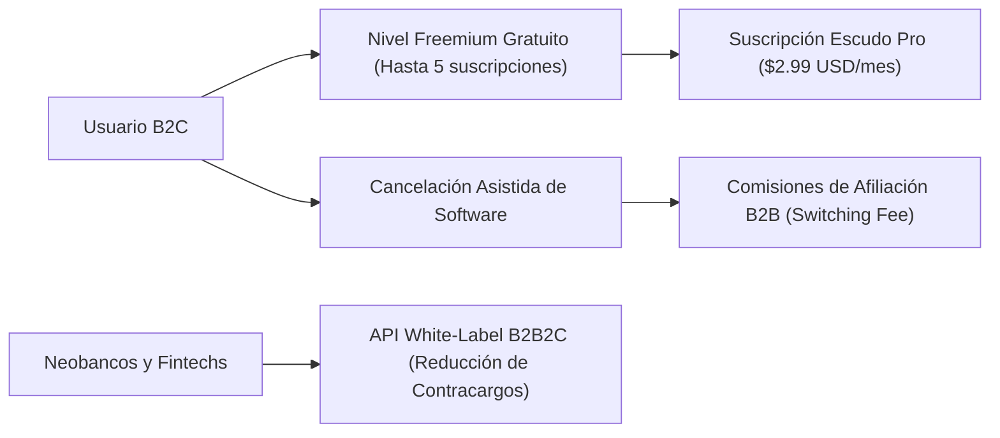

# Dossier Estratégico y Pitch Comercial: Cazador de Gastos Hormiga
## Presentación Ejecutiva para Inversionistas y Comités de Producto (Estilo Y Combinator)

---

### 1. Identidad de Marca y Elevator Pitch

- **Nombre oficial del producto:** Cazador de Gastos Hormiga (*Hormiga Financial Defense Platform*).
- **Categoría:** *Personal Finance Management (PFM) / FinTech Consumer Defense & Subscription Intelligence*.
- **Elevator Pitch (15 palabras exactas):**
  > **«Blindamos tu dinero erradicando suscripciones invisibles, sobrecostos en dólares y trampas de retención digital automáticas.»**

---

### 2. El Problema Real de Mercado (The Hair-on-Fire Problem)

#### 2.1 La anatomía del dolor
En la economía contemporánea de suscripción (*Subscription Economy*), las empresas han perfeccionado el modelo de débito automático recurrente. El resultado para el consumidor es una **hemorragia financiera inadvertida**:
1. **Fricción por fragmentación:** Un usuario promedio gestiona entre cuatro y ocho suscripciones activas (servicios de transmisión multimedia, almacenamiento en la nube, herramientas de inteligencia artificial, gimnasios, cajas de suscripción y utilidades móviles).
2. **Asimetría de información y subestimación del gasto:** Más del 80% de los consumidores subestiman su gasto mensual recurrente en un 200% a 300% (fuente: *C+R Research / Chase Financial Insights*).
3. **La trampa del periodo de prueba (*Free Trial Traps*):** El 42% de los usuarios que aceptan un periodo de prueba gratuita con tarjeta de crédito olvidan cancelarlo antes del vencimiento, pagando entre tres y nueve meses de renovación forzada.
4. **Vulnerabilidad cambiaria en economías emergentes (Riesgo TRM):** En mercados de América Latina, las herramientas tecnológicas más demandadas (ChatGPT Plus, Spotify, Netflix, Adobe, iCloud, Midjourney) facturan en dólares estadounidenses (USD). Si la divisa local se devalúa un 5% o 10%, el costo de vida digital aumenta sin que el usuario reciba un aviso de sus entidades bancarias.
5. **Patrones oscuros de retención (*Dark Patterns*):** Las plataformas diseñan deliberadamente laberintos digitales (*roach motels*), ocultando el botón de cancelación tras múltiples pantallas de confirmación y advertencias engañosas, lo que provoca que el usuario desista del intento de baja por frustración.

#### 2.2 Cuantificación del dolor en el mercado objetivo
- En Colombia y la región andina, una sola suscripción desatendida de **\$19.99 USD mensuales** equivale a una fuga de **\$796.446 COP al año** (a una tasa promedio de \$3.980 - \$4.200 COP/USD).
- Tres suscripciones inactivas o redundantes destruyen anualmente más de **\$2.380.000 COP** del presupuesto familiar, dinero que no genera bienestar ni utilidad tangible.

---

### 3. La Solución: Las 4 Funcionalidades Estrella en Código y su Valor de Negocio

A diferencia de las herramientas contables convencionales que actúan como "autopsias financieras" mostrando el dinero cuando ya fue debitado, **Cazador de Gastos Hormiga** opera como un **sistema de defensa activa anticipada**.

| # | Funcionalidad Programada en App / Web | Sustento Técnico en Código | Beneficio Directo y Valor para el Usuario |
| :-: | :--- | :--- | :--- |
| **1** | **Diagnóstico Algorítmico Multicriterio de Rentabilidad (*Ghost Expense Engine*)** | Motor analítico en Java 21 (`AnalyticsService.java`) y vistas SQL (`v_subscription_metrics`) que cruzan costo normalizado ($C_m$, $C_a$), frecuencia declarada (`daily`, `weekly`, `monthly`, `rarely`, `never`) y utilidad percibida (escala 1★ a 5★). | **Claridad decisoria inmediata.** Identifica sin ambigüedades qué servicios son "parásitos" (*Gasto Hormiga Crítico*). El usuario no pierde horas revisando extractos; el sistema calcula exactamente el capital líquido que recuperará al cancelarlos. |
| **2** | **Radar de Alertas Pre-Cobro de 48 Horas (*Anti-Auto-Renewal Alert*)** | Procesos de fondo diarios y consultas temporales en Supabase/Spring Boot (`NotificationService.java`, tabla `notification_logs`) que calculan la diferencia exacta $\Delta t \le 48\text{ h}$ para cobros y vencimientos de *free trials*. | **Cero cobros sorpresa.** Otorga una ventana táctica de dos días para evaluar si se mantiene el servicio o se interrumpe antes de que el procesador bancario efectúe el débito automático. |
| **3** | **Directorio Antipatrones Oscuros con Desconexión en 1 Clic (*Frictionless Unsubscribe Hub*)** | Módulo reactivo (`CancellationGuidesModal.tsx`, `GuidesFragment.kt`) con persistencia en PostgreSQL (`cancellation_guides`), que incluye enlaces directos de desuscripción, advertencias de retención y pasos secuenciales. | **Ahorro de tiempo y neutralización del secuestro digital.** Reduce el proceso de cancelación de 20 minutos de frustración en menús ocultos a menos de 90 segundos guiados, protegiendo al usuario contra tácticas de retención engañosas. |
| **4** | **Simulador de Sensibilidad Cambiaria en Tiempo Real + Métrica de Dinero Recuperado (*TRM Live & Proof-of-Value*)** | Integración con API de divisas (`CurrencyService.java`), motor de amortiguación (+5% / -5%) y acumulador de "Ahorro Protegido" en perfiles de usuario (`ProfileModal.tsx`, `UsdImpactBottomSheet.kt`). | **Protección macroeconómica y gamificación del ahorro.** Proyecta el sobrecosto a 12 meses ante la volatilidad del dólar y transforma cada cancelación en un triunfo financiero visible: el usuario ve crecer su saldo anual acumulado por haber neutralizado gastos innecesarios. |

---

### 4. Diferenciador Tecnológico: ¿Por qué nuestra arquitectura es superior?

1. **Defensa Activa vs. Contabilidad Forense Pasiva:**
   - Plataformas existentes como Mint, YNAB o Fintonic se limitan a catalogar gastos una vez consumados.
   - Cazador de Gastos interviene preventivamente mediante ventanas de alerta previa y facilitación de la cancelación.
2. **Arquitectura Empresarial Desacoplada de Alta Disponibilidad:**
   - **Backend Central:** Construido sobre **Java 21 LTS** y **Spring Boot 3**, alojado en contenedores Render con despliegue CI/CD automatizado. Ofrece transaccionalidad bancaria estricta, cálculos financieros con precisión decimal exacta (`BigDecimal`) y documentación viva OpenAPI/Swagger.
   - **Capa de Persistencia y Seguridad Granular:** **PostgreSQL en Supabase Cloud** con políticas de seguridad a nivel de fila (*Row Level Security - RLS*), asegurando aislamiento estricto de los registros de cada usuario y optimizando las consultas mediante vistas analíticas nativas.
   - **Despliegue Multiplataforma Nativo:**
     - *Cliente Móvil:* Desarrollado en **Kotlin nativo** (Android SDK 34, Jetpack, Material Design 3, Retrofit) con instalador APK optimizado de ~7.5 MB, diseñado para alta eficiencia energética y soporte sin conexión a internet.
     - *Cliente Web:* Desarrollado en **React 18**, **Vite 6** y **Tailwind CSS**, alojado con redundancia global en GitHub Pages y Render, garantizando accesibilidad de alto contraste (WCAG AAA) y tiempos de carga inferiores a 800 milisegundos.
3. **Fricción Cero de Adopción (Privacidad Garantizada):**
   - No requiere compartir credenciales bancarias ni contraseñas de portales financieros en su fase de entrada, superando la principal barrera de desconfianza que enfrentan las *fintechs* en América Latina.

---

### 5. Modelo de Negocio, Monetización y Escalabilidad

#### 5.1 Vías de Ingresos Diversificadas

1. **Modelo Freemium B2C (*Subscription Shield Pro*):**
   - *Plan Gratuito:* Registro y monitoreo de hasta 5 servicios, alertas básicas por correo y acceso al directorio de cancelación.
   - *Plan Pro (\$2.99 USD / mes o \$24.99 USD / año - aprox. \$12.000 COP / mes):* Suscripciones ilimitadas, alertas prioritarias vía WhatsApp Business, sincronización bancaria automática, monitoreo multidivisa ampliado y reportes ejecutivos descargables en PDF.
   - *Justificación económica para el usuario:* Al cancelar una sola suscripción de \$19.99 USD, el servicio se paga por sí mismo durante más de medio año.

2. **Monetización por Sustitución Inteligente (*Affiliate & Switching Marketplace*):**
   - Cuando el usuario decide cancelar un servicio costoso (por ejemplo, una suite de diseño a \$54.99 USD/mes), la plataforma presenta alternativas costo-eficientes verificadas. La plataforma percibe comisiones por adquisición de clientes (*CPA*) de entre \$15 y \$50 USD por usuario redirigido exitosamente.

3. **Alianzas B2B2C con Neobancos y Emisores de Tarjetas:**
   - Integración *White-Label* o SDK para aplicaciones bancarias (Nu, Lulo Bank, RappiCard, Ualá).
   - *Propuesta para el banco:* Reducción drástica de contracargos (*chargebacks*) y llamadas a soporte al cliente por cobros recurrentes no reconocidos, los cuales representan un costo operativo crítico para la industria bancaria.

#### 5.2 Proyección de Crecimiento y Escalabilidad a 18 Meses

- **Fase 1 (Meses 1 - 6) - Validación y Product-Market Fit:**
  - Enfoque geográfico: Colombia y México.
  - Meta de tracción: 50.000 usuarios activos mensuales (MAU).
  - Tasa de conversión a Premium estimada: 4.0% (2.000 suscriptores).
  - Ingresos Mensuales Recurrentes (MRR): **\$6.000 USD**.

- **Fase 2 (Meses 7 - 12) - Expansión Regional y Automatización con IA:**
  - Expansión a Brasil, Chile y Perú.
  - Implementación del agente autónomo de desuscripción (*Click-to-Cancel Agent*).
  - Meta de tracción: 250.000 usuarios activos mensuales.
  - Ingresos Mensuales Recurrentes (MRR): **\$35.000 USD** (combinando suscripciones y comisiones de *switching*).

- **Fase 3 (Meses 13 - 18) - Escala Fintech e Integración B2B:**
  - Cierre de 2 contratos corporativos con neobancos regionales.
  - 1.000.000 de usuarios gestionados.
  - Tasa Anual de Ingresos Recurrentes (ARR): **\$750.000 USD**, con un margen bruto operativo superior al 82%.
